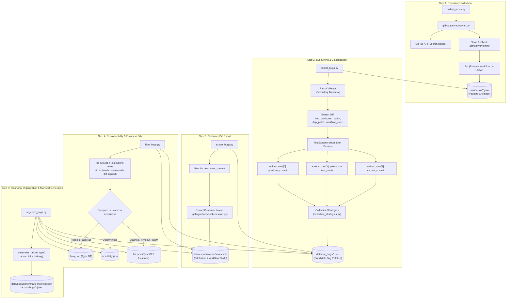
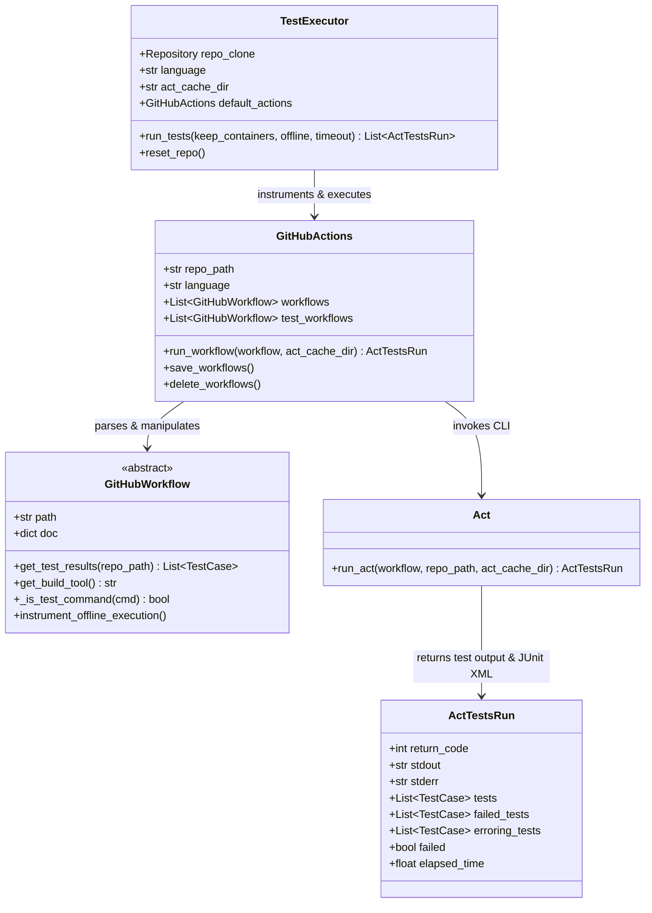
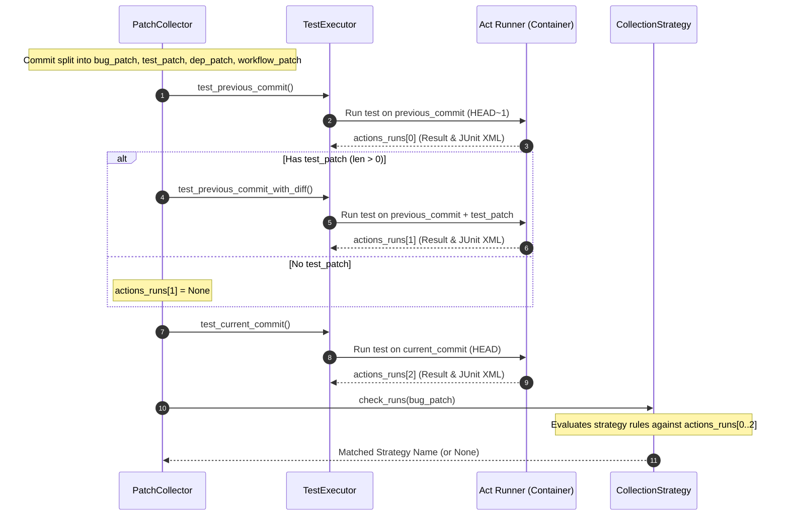

# GitBugActions Architecture & Core Logic Guide

This document describes the architectural layout, core pipeline workflows, and key logic files of the **GitBugActions** framework.

---

## 1. System Architecture Overview

GitBugActions extracts reproducible bugs and failure benchmarks from GitHub repositories that use GitHub Actions. It executes tests in local containers using **`nektos/act`** (via Podman/Docker) to simulate GitHub Actions CI environments.

### 5-Step Pipeline Architecture

---

## 2. Execution Engine & Act Abstraction Layer

The execution engine translates repository test commands into local Docker/Podman containers via `nektos/act`.

---

## 3. Core Files & Where to Check Key Logic

Below is the directory map of the most critical files, what they do, and where to inspect specific logic:

### Root Pipeline Scripts

| File | Primary Responsibility | Where to Check Core Logic |
| :--- | :--- | :--- |
| [`collect_repos.py`](file:///home/tuanlh/Documents/UIT/sem5/test/research/gitbugactions/collect_repos.py) | **Step 1**: Searches GitHub for repositories, clones them, and runs Act on `HEAD` to verify test workflows pass. | • `CollectReposStrategy.handle_repo()` (clone & language check) • `run_workflow()` (Act execution on candidate repo) |
| [`collect_bugs.py`](file:///home/tuanlh/Documents/UIT/sem5/test/research/gitbugactions/collect_bugs.py) | **Step 2**: Traverses Git history, isolates patches into types (source, test, dep, workflow), executes 3 Act test phases, and matches collection strategies. | • `PatchCollector.get_possible_patches()` (commit diff separation & commit-message filter) • `PatchCollector.test_patch()` (runs 3 Act phases) • `PatchCollector.check_runs()` (checks matched strategy) |
| [`export_bugs.py`](file:///home/tuanlh/Documents/UIT/sem5/test/research/gitbugactions/export_bugs.py) | **Step 3**: Builds/runs `current_commit` and extracts changed filesystem layers into a diff tarball. | • `export_bug_containers()` (orchestrates container run) • `create_exported_containers()` (extracts layers & workflow YAML) |
| [`filter_bugs.py`](file:///home/tuanlh/Documents/UIT/sem5/test/research/gitbugactions/filter_bugs.py) | **Step 4**: Validates reproducibility and detects flaky tests or environment crashes over `n_executions` identical re-runs. | • `filter_bug()` (builds diff image and executes repeated test runs) • `equal_test_results()` (compares test outcomes across runs to flag flakiness) |
| [`organize_bugs.py`](file:///home/tuanlh/Documents/UIT/sem5/test/research/gitbugactions/organize_bugs.py) | **Step 5**: Consolidates bugs, validates soundness, determines the final failure taxonomy type, and writes `benchmark_manifest.json`. | • `determine_failure_type()` (maps filter status + strategy to `TYPE_A`–`TYPE_E` or `PASS`) • `has_infra_failure()` (verifies exit 124 timeout or exit 137 OOM) |
| [`run_batch.sh`](file:///home/tuanlh/Documents/UIT/sem5/test/research/gitbugactions/run_batch.sh) | Driver shell script executing Steps 1 to 5 sequentially with specified flags, strategies, and cache settings. | Batch pipeline arguments and strategy list. |

---

### Internal Package: `gitbugactions/`

| File / Submodule | Purpose & Logic |
| :--- | :--- |
| [`gitbugactions/collect_bugs/collection_strategies.py`](file:///home/tuanlh/Documents/UIT/sem5/test/research/gitbugactions/gitbugactions/collect_bugs/collection_strategies.py) | **Strategy Taxonomy Engine**: Defines each strategy's criteria. • `PassPassStrategy` & `FailPassStrategy` (`TYPE_A`) • `DependencyConflictStrategy` (`TYPE_B`) • `PipelineConfigStrategy` (`TYPE_C`) • `PreExistingFailureStrategy` (`TYPE_E`) • `NormalPassStrategy` (`PASS`) |
| [`gitbugactions/collect_bugs/bug_patch.py`](file:///home/tuanlh/Documents/UIT/sem5/test/research/gitbugactions/gitbugactions/collect_bugs/bug_patch.py) | **Patch Data Structure & Git State Manager**: Holds patch diffs (`bug_patch`, `test_patch`, `dependency_patch`, `workflow_patch`). Manages pygit2 commit reset, patch application, and property helpers (`prev_commit_failed`, `curr_commit_passed`, etc.). |
| [`gitbugactions/test_executor.py`](file:///home/tuanlh/Documents/UIT/sem5/test/research/gitbugactions/gitbugactions/test_executor.py) | **Local Test Harness**: Coordinates repository state preparation, GitHub Actions workflow instrumentations, container execution via Act, and JUnit XML test report extraction. |
| [`gitbugactions/actions/actions.py`](file:///home/tuanlh/Documents/UIT/sem5/test/research/gitbugactions/gitbugactions/actions/actions.py) | **Act CLI Wrapper & Result Parser**: Manages concurrent act cache directories (`ActCacheDirManager`), spawns the Act CLI, parses test result objects, and categorizes run outcomes (`ActTestsFailureStrategy`). |
| [`gitbugactions/actions/workflow_factory.py`](file:///home/tuanlh/Documents/UIT/sem5/test/research/gitbugactions/gitbugactions/actions/workflow_factory.py) | **Workflow Parser Factory**: Detects workflow language and instantiates language-specific workflow handlers (`MavenWorkflow`, `PytestWorkflow`, `GoWorkflow`, `NpmWorkflow`, etc.). |
| [`gitbugactions/actions/<lang>/`](file:///home/tuanlh/Documents/UIT/sem5/test/research/gitbugactions/gitbugactions/actions) | **Language-Specific Handlers**: Contains custom parsers that locate and parse test reports (e.g. `surefire-reports` for Maven, `.junitxml` for pytest, Mocha/Jest reporters). |
| [`gitbugactions/docker/export.py`](file:///home/tuanlh/Documents/UIT/sem5/test/research/gitbugactions/gitbugactions/docker/export.py) | **Container Diff Utilities**: Exports Docker/Podman container filesystem layers and tarballs to persist the exact environment state. |
| [`gitbugactions/utils/file_utils.py`](file:///home/tuanlh/Documents/UIT/sem5/test/research/gitbugactions/gitbugactions/utils/file_utils.py) | **File Path & Type Classifier**: `get_file_type()` determines whether a file belongs to `SOURCE`, `TESTS`, `DEPENDENCY` (`pom.xml`, `package.json`, `requirements*.txt`, `setup.py`), `WORKFLOW` (`.github/workflows/*`), or `NON_CODE`. |

---

## 4. How Data Flows Across the 3 Test Phases in Step 2

In [`collect_bugs.py`](file:///home/tuanlh/Documents/UIT/sem5/test/research/gitbugactions/collect_bugs.py), each candidate commit undergoes up to three distinct local test phases via Act:

1. **`actions_runs[0]` (`previous_commit`)**: Checks baseline behavior before the commit.
2. **`actions_runs[1]` (`previous_commit + test_patch`)**: Exposes whether new or modified tests fail when running against old source code (used to catch semantic bugs in `PASS_PASS` / `TYPE_A` and dependency breaks in `TYPE_B`).
3. **`actions_runs[2]` (`current_commit`)**: Confirms whether the current commit successfully passes and resolves the issue.
